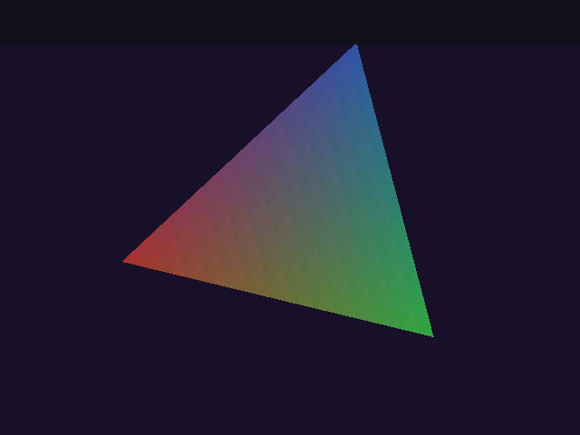

# Nora OS

**Un sistema propio para la Anbernic RG35XX *original* (2022, Actions ATM7039S), con la GPU funcionando.**

*A custom OS for the original Anbernic RG35XX: it lives connected to your PC, runs apps and games written in Lua, and — for the first time on this handheld — uses its PowerVR SGX544 GPU.*

> Estado: **fase 0 terminada** (los cimientos). Todavía no hay una imagen para grabar: esto es el banco de pruebas del que saldrá.

## Qué es

Nora convierte la RG35XX en una pantallita viva que se conecta al PC por el cable USB-C (o por Wi-Fi): enseña lo que importa (cuánto te queda de Claude o Codex, avisos, permisos que aprobar con A/B), suena, responde a los botones y se le instalan **apps y juegos propios en Lua** desde el PC, sin recompilar nada.

Vive **encima del kernel y del arranque de Anbernic**, que no se tocan, igual que GarlicOS sustituye al menú de fábrica. Puede arrancar **sola** (es `/misc/dmenu.bin`, el guion que lanza el sistema de Anbernic: `arranque/arranque-propio.sh`, se deshace con `--quitar`) o encima de GarlicOS (`CFW/autostart`). Arrancando sola, GarlicOS queda de reserva: SELECT al encender, tres fallos seguidos, o *Energía → Ir a GarlicOS*. El servicio del PC está en un repo aparte: [`nora-puente`](https://github.com/k4ditano/nora-puente).

## La GPU

La RG35XX original lleva una PowerVR SGX544, pero ningún sistema la usaba: Anbernic la dejó **desactivada** en su device tree y sin las librerías de usuario. Aquí funciona con OpenGL ES 2.0 **en ventana a 363 fps** (2,3 ms por fotograma a la pantalla). Cómo:

1. **Librerías**: las de la LeMaker Guitar (chip S500, primo del ATM7039S) son de la misma versión exacta que el driver de la consola, `1.12@3052601`. No se incluyen: `gpu/bajar-blobs.sh` las baja de su repo público.
2. **Lo que les falta** (`libhardware`, `libcrypto`, `libsync`, `libunwind`, un `liblog` que saca el log por stderr y algunas funciones de libc), en `gpu/shims/`, compilado contra el bionic de la propia consola (`gpu/traer-bionic.sh`).
3. **`gpu/despertar/despertar_gpu.ko`**: marca la GPU como `okay` en memoria y crea su dispositivo, sin tocar la tarjeta.
4. **Orden de arranque** (`gpu/arrancar-gpu.sh`): despertar → `pvrsrvkm` → `pvrsrvctl --start` → `dc_owl`. Otro orden da un oops, y `pvrsrvkm` no se puede descargar.
5. **Ventana propia** (`gpu/triangulo/ventana.c`): un `ANativeWindow` hecho a mano sobre `gralloc`, con triple buffer en `/dev/fb0`. Los programas son ejecutables de bionic compilados sin el NDK (`arranque.S` llama a `__libc_init`).



## Carpetas

| | |
|---|---|
| `gpu/` | todo lo de la GPU: librerías de relleno, módulo, pruebas, scripts |
| `prototipos/` | la fase 0: cara con risa, fichas de uso animadas, sonido ALSA propio, app USB-Red |
| `herramientas/` | telnet, subir archivos y capturar la pantalla de la consola desde el PC |
| `diseno/` | maquetas de las pantallas de Nora y del extra de la barra (`maquetas.py`) |

## Instalar Nora en una tarjeta (sin GarlicOS)

Con la imagen **oficial de Anbernic** para la RG35XX original (descárgala tú: es de Anbernic y no se
puede redistribuir), el núcleo compilado (`nucleo/construir.sh`) y las librerías de la GPU
(`gpu/bajar-blobs.sh` y `gpu/construir-shims.sh`):

```sh
sudo python3 herramientas/crear-tarjeta.py --imagen RG35XX-oficial.img.xz --tarjeta /dev/sdX   # BORRA la tarjeta
python3 herramientas/crear-tarjeta.py --imagen RG35XX-oficial.img --salida nora-os.img --tamano 16G
```

Graba la imagen de Anbernic, agranda la partición de juegos a toda la tarjeta (conservando lo que tenía),
pone el arranque de Nora en `/misc/dmenu.bin` (el menú de serie queda de reserva: SELECT al encender) y
copia Nora con busybox. La primera vez sale la bienvenida (tema, conectar con el PC, trucos).

En una tarjeta que ya tiene GarlicOS: `arranque/arranque-propio.sh` (se deshace con `--quitar`).

## Actualizar

Con la consola conectada al PC por el cable y [`nora-puente`](https://github.com/k4ditano/nora-puente)
corriendo: `nora-puente actualizar` manda lo que ha cambiado en el repo (núcleo, apps, librería, temas,
sonidos, arranque) y relanza Nora en unos segundos. Sin telnet.

La red por el cable está siempre (la usa el puente; `nora/sin-red` en la tarjeta la quita). El
**telnet** (consola de root sin contraseña, para desarrollar) solo si existe `nora/telnet`.

## Qué hace falta para desarrollar

- Una RG35XX **original** (USB `10d6:10d6` en modo ADFU). **Nada de esto vale para las Plus/H/SP/2024**, que llevan Allwinner H700.
- Una tarjeta con Nora (arriba) y `nora/telnet` en ella para tener telnet (lo usan `arranque/actualizar.sh`, `herramientas/consola.py`…); o una con GarlicOS y la app `prototipos/usb/USB-Red.sh` en `Roms/APPS/`.
- En el PC, la toolchain ARMv7 de Bootlin (glibc, gcc 5.4) y el kernel 3.10.37 preparado para compilar módulos.

## Hoja de ruta

1. **Núcleo** (siguiente): C + OpenGL ES 2.0 a 60 fps, LuaJIT dentro con la API `nora.*`, lanzador, barra de estado, avisos y menú rápido.
2. **Puente y Bahía**: `nora-puente` en el PC y el extra «Nora» en la barra.
3. **Que sirva de verdad**: aprobar permisos de Claude Code con A/B, música, atajos del escritorio.
4. **Que viva sola** (hecho): arranque propio, energía, instalador, actualizar desde el PC. Falta: Wi-Fi, reposo profundo, RetroArch.

## Licencia

MIT, salvo `gpu/despertar/` (GPL-2.0, como todo módulo del kernel Linux). Las librerías de Imagination y el bionic de Anbernic no están en el repo.
